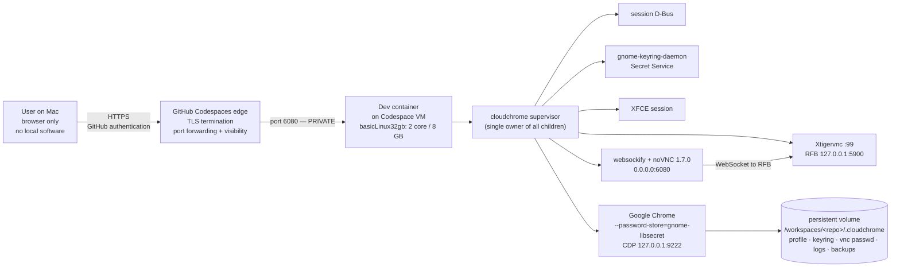
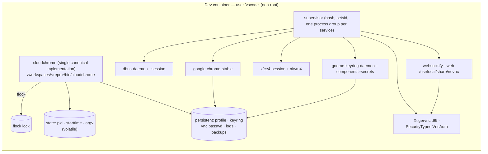
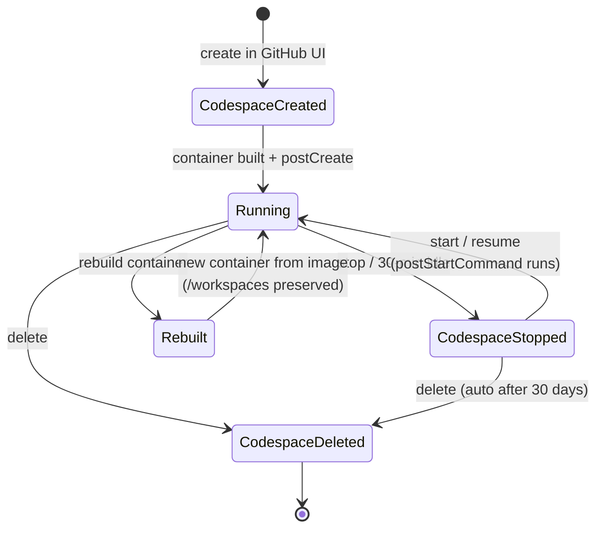

# Cloud-Chrome — Phase 0 Architecture Blueprint (Revision 2)

| | |
|---|---|
| **Status** | DESIGN ONLY — no implementation, no repository changes, no test or benchmark results exist |
| **Revision** | 2 (supersedes Revision 1 of 2026-11-10; see §16 Change Log) |
| **Date** | 2026-11-10 |
| **Target** | GitHub Codespaces dev container — Docker + XFCE + TigerVNC Xvnc + noVNC + Google Chrome Stable |
| **Repo** | `mosabbir-maruf/Cloud-Chrome` (empty, `main`, created 2026-11-10) |
| **Hard constraint** | The user's Mac requires **no installed software of any kind**. Browser only. |

Every version below was verified against upstream on 2026-11-10. Every performance figure is a **target to be
measured**, never a claim. Section 1 separates **verified fact**, **hypothesis**, and **platform-specific
unknown** so that no assumption is presented as a fact.

---

## 1. Evidence register — fact vs hypothesis vs unknown

Nothing in §2–§15 depends on an unproven assumption being *true*; where an assumption matters, it is listed
here and gated behind an experiment in the roadmap (§14).

### 1.1 Verified facts (checked against upstream on 2026-11-10)

| # | Fact | Source |
|---|---|---|
| F1 | Codespaces machine types: `basicLinux32gb` = 2 cores / **8 GB** RAM / 32 GB storage; `standardLinux32gb` = 4 cores / **16 GB** RAM / 32 GB storage; `premiumLinux` = 8/32/64; `largePremiumLinux` = 16/64/128 | GitHub Docs "Changing the machine type" + REST `/repos/:owner/:repo/codespaces/machines` |
| F2 | Machine-type switching is currently supported only **between types with the same storage spec** (32 GB → 32 GB is switchable in place) | GitHub community response, GitHub support |
| F3 | Pricing: 2-core **$0.18/h**, 4-core **$0.36/h**, 8-core $0.72/h, 16-core $1.44/h, 32-core $2.88/h; storage $0.07/GB-month | GitHub Docs — Codespaces billing |
| F4 | Included quota (GitHub Free personal): **120 core-hours / month** + **15 GB-month storage** → 60 wall-clock hours on 2-core, 30 h on 4-core. Pro: 180 core-hours + 20 GB-month | GitHub Docs — Codespaces billing |
| F5 | A stopped Codespace still accrues **storage** charges until deleted; a **custom dev container image counts toward storage** | GitHub Docs — Codespaces billing |
| F6 | `/workspaces` is preserved across **stop/start and rebuild**; the container filesystem outside it is preserved across stop/start but **lost on rebuild** | GitHub Docs — "Persisting data over a rebuild" |
| F7 | Idle auto-stop after **30 minutes** (default, configurable); **12-hour** maximum lifetime; auto-delete after **30 days** inactive (default) | GitHub Docs — "Understanding the codespace lifecycle" |
| F8 | Forwarded port visibility: `private` (default, requires GitHub authentication + Codespace authorization), `org`, `public` (**no authentication** for public) | GitHub Docs — "Forwarding ports in your codespace" |
| F9 | Dev Container lifecycle hooks exist: `onCreateCommand`, `updateContentCommand`, `postCreateCommand`, **`postStartCommand`**, `postAttachCommand` | Dev Container metadata reference |
| F10 | `devcontainer.json` supports `runArgs` (`--security-opt`, `--cap-add`, `--cap-drop`, `--shm-size`, `--init`), `forwardPorts`, `portsAttributes` (incl. `onAutoForward`), `hostRequirements` (`cpus`/`memory`/`storage`), `remoteUser`, `containerEnv` | Dev Container metadata reference + Codespaces docs |
| F11 | Ubuntu noble ships **TigerVNC 1.13.1** and **renames the binaries**: `Xtigervnc` (X+VNC server) in `tigervnc-standalone-server`; `tigervncpasswd` in `tigervnc-tools`; `tigervncconfig` in `tigervnc-common`. There is no `Xvnc`/`vncpasswd` on Ubuntu | Ubuntu package file lists |
| F12 | Ubuntu noble ships **noVNC 1.3.0** (2020) and **websockify 0.10.0** | Launchpad API |
| F13 | TigerVNC upstream latest = **1.16.2**; the 1.16.1→1.16.2 security fix is in **x0vncserver** (not Xvnc); upstream describes x0vncserver as "an inefficient VNC server which continuously polls" | TigerVNC releases + docs |
| F14 | noVNC upstream latest = **1.7.0** (2026-04-28) | noVNC releases |
| F15 | Chromium Linux password stores: **GNOME Libsecret**, KWallet 4/5/6, **plain text**. `--password-store=gnome-libsecret` selects Libsecret. **"Chromium will fall back to basic if a requested or autodetected store is not available."** | Chromium `docs/linux/password_storage.md` |
| F16 | OSCrypt with Libsecret stores a **randomised key in Libsecret**; data encrypted that way is prefixed **`v11`**, versus the hardcoded-key scheme prefixed **`v10`** | Chromium `components/os_crypt/key_storage_linux.cc`, crbug 40464669 |
| F17 | `gnome-keyring` provides `/usr/bin/gnome-keyring-daemon` (Secret Service provider); `libsecret-1-0` provides `libsecret-1.so.0` (Chrome `dlopen`s it — it is **not** a Chrome dependency); `libsecret-tools` provides `secret-tool`; `dbus-x11` provides `dbus-launch` | Ubuntu package file lists |
| F18 | `age` upstream latest = **1.3.2** (2026-08-29), static linux-amd64/arm64 binaries + `.proof` files | age releases |
| F19 | `age -p/--passphrase` = "Encrypt with a passphrase, **requested interactively from the terminal**". age reads the secret from `/dev/tty`; **without a TTY it fails** ("standard input is not a terminal"). age core has **no** non-interactive passphrase option; v1.3.0 added the optional `age-plugin-batchpass` | age `doc/age.1.ronn`, `cmd/age/tui.go`, `internal/term/term.go` |
| F20 | age uses **authenticated encryption** (ChaCha20-Poly1305): tampering is detected on decryption | age format spec |
| F21 | Docker's **default** seccomp profile blocks `unshare`/`setns` (observed `EPERM` under Docker 29.7); the container's **capability bounding set excludes `CAP_SYS_ADMIN`**, which the Chromium setuid sandbox helper requires | moby profile docs + field observation + Chromium sandbox README |
| F22 | Chromium: `--no-sandbox` "should never be used when browsing the open web" | Chromium `apparmor-userns-restrictions.md` |
| F23 | `gh codespace cp` copies files between local and Codespace filesystems | GitHub CLI manual |
| F24 | `mcr.microsoft.com/devcontainers/base` publishes `ubuntu-24.04` (3.0.7/3.0.8/3.0.9-ubuntu24.04) | MCR tag list |
| F25 | The `desktop-lite` Dev Container Feature (v1.2.10) = Fluxbox + TigerVNC + noVNC **1.6.0**, default VNC password `"vscode"` | devcontainers/features source |

### 1.2 Hypotheses (to be confirmed by a Phase 1 experiment, not assumed)

| # | Hypothesis | How it is tested |
|---|---|---|
| H1 | The Codespaces host kernel permits unprivileged user namespaces (`/proc/sys/user/max_user_namespaces` > 0, no AppArmor `apparmor_restrict_unprivileged_userns` block) | Probe set P1–P3 (§6.4) inside a real Codespace |
| H2 | A tailored `--security-opt seccomp=<path>` profile **under `/workspaces`** is readable by the Docker daemon that creates the Codespace container | Create a Codespace with the profile; `docker inspect` the applied `SecurityOpt`; re-run probe P3 |
| H3 | `postStartCommand` executes on every container start, including resume of a stopped Codespace | Stop → start a Codespace; check the supervisor state file and logs |
| H4 | `gnome-keyring-daemon` can be unlocked headlessly (stdin passphrase) and Chrome then uses the Libsecret backend (`v11`) | Probe P5 + password-store verification (§6.6) |
| H5 | The Codespaces port forwarder can reach a container port bound to `0.0.0.0` (not only `127.0.0.1`) | Forward 6080 and load `vnc.html` from the browser |
| H6 | TigerVNC 1.13.1's `Xtigervnc` is free of Xvnc-affecting CVEs | Read the TigerVNC 1.13.1→1.16.2 release notes; check the Ubuntu USN list |
| H7 | `Xtigervnc` supports `-SecurityTypes VncAuth -rfbauth <file>` in the Ubuntu build | `Xtigervnc -help` in the built image |
| H8 | `tigervncpasswd -f` writes the obfuscated password file | `tigervncpasswd -help` in the built image |

### 1.3 Platform-specific unknowns (cannot be resolved from outside Codespaces)

| # | Unknown | Consequence if it is unfavourable |
|---|---|---|
| U1 | Host AppArmor `kernel.apparmor_restrict_unprivileged_userns` | Chromium's user-namespace sandbox is unavailable → the only supported path is the setuid sandbox, which needs `CAP_SYS_ADMIN` → **fail closed** if not approved |
| U2 | Whether the Docker daemon can read a seccomp profile from `/workspaces` | H2 false → no tailored seccomp → same as U1 |
| U3 | Host `kernel.unprivileged_userns_clone` (Debian/Ubuntu sysctl) | Userns unavailable → same as U1 |
| U4 | Whether the Codespaces host permits `CLONE_NEWUSER` via `clone()` when `unshare()` is blocked | Chrome's sandbox uses one of the two → must be probed individually |
| U5 | Codespaces-specific port-forwarding details (bind address, auth headers) | Only affects how the user opens the page, not the security boundary (F8) |

**Design rule:** the design never *depends* on U1–U5 being favourable. Each has a defined fallback, and the
final fallback is **fail closed**, never "disable the sandbox".

---

## 2. Architecture

### 2.1 Context



### 2.2 Container internals



### 2.3 Component responsibilities

| Component | Responsibility | Bind | Notes |
|---|---|---|---|
| `cloudchrome` | All user verbs; config; identity validation; health; logs; backup | – | **One** implementation in the repo (`bin/cloudchrome`); a tiny launcher on `PATH` resolves it (§9.3) |
| Supervisor | Owns every child; start order; bounded restart; graceful shutdown | – | One process; one process group per service |
| `dbus-daemon --session` | Session bus | – | Prerequisite for keyring, XFCE and Chrome notifications |
| `gnome-keyring-daemon` | Secret Service (Chrome's password-store backend) | – | Unlocked from a 0600 file on the persistent volume |
| `Xtigervnc` | Virtual X display **and** RFB server | `127.0.0.1:5900` | Never forwarded; never exposed |
| `xfce4-session` | DE + window manager | X display | `minimal` mode optional |
| `google-chrome-stable` | The browser | CDP `127.0.0.1:9222` | Sandbox mandatory (§6.4); Libsecret password store mandatory (§6.6) |
| `websockify` | noVNC static assets + WebSocket↔TCP bridge | `0.0.0.0:6080` | The only forwarded port |

### 2.4 Why `Xtigervnc` (TigerVNC) rather than `Xvfb` + a polling VNC server

| Option | CPU model | Verdict |
|---|---|---|
| `Xvfb` + `x11vnc` | x11vnc polls the framebuffer and diffs it in RAM | Rejected — polling is the known slow path |
| `Xvfb` + `x0vncserver` | Upstream: "an inefficient VNC server which continuously polls" | Rejected — also the component with the 1.16.1 security fix (F13) |
| **`Xtigervnc`** | X server renders straight into the VNC framebuffer — no polling | **Chosen** |
| `desktop-lite` Feature | TigerVNC + noVNC 1.6.0 + Fluxbox, default password `"vscode"` | Rejected — Fluxbox ≠ XFCE, older noVNC, hardcoded weak default, no CLI (kept as reference) |

---

## 3. Service lifecycle

### 3.1 Two lifecycles — explicitly separated

| | **Browser lifecycle** (this repo) | **Codespace lifecycle** (GitHub) |
|---|---|---|
| Scope | Processes inside the dev container | The Codespace VM + its container |
| Controlled by | `cloudchrome start/stop/restart/status/logs/doctor` | GitHub UI, or `gh codespace start/stop/delete/rebuild` |
| Owner | This repository | GitHub |
| `stop` effect | Ends Xvnc, XFCE, Chrome, websockify, keyring, D-Bus | Ends **everything**, including the container |
| Data | Profile/keyring/password files on the persistent volume | `/workspaces/<repo>` preserved over stop/start **and** rebuild (F6) |
| Idle | None of its own | Auto-stop 30 min idle; 12 h max lifetime; auto-delete 30 days (F7) |
| Cost | None | Compute while running; **storage while it exists** (F5) |

**Rule:** `cloudchrome stop` is never described as "stopping the Codespace", and `gh codespace stop` is never
described as "stopping Chrome".



### 3.2 Automatic startup (minimal manual effort)

| Trigger | Hook | Command | Effect |
|---|---|---|---|
| First creation | `postCreateCommand` | `cloudchrome init` | Creates persistent dirs, generates the VNC password file and the keyring passphrase, fixes permissions. Idempotent |
| Every container start (incl. resume) | `postStartCommand` | `cloudchrome start --if-needed` | Starts the supervisor and all services; no-op if already healthy (H3 verifies this fires on resume) |
| Port exposure | `forwardPorts: [6080]` + `portsAttributes` | — | Port 6080 is auto-forwarded; visibility stays **private** by default (F8); `onAutoForward: "notify"` shows a clickable link |
| Machine floor | `hostRequirements: {cpus: 2, memory: "8gb", storage: "32gb"}` | — | Prevents sub-2-core machines; 4-core/16 GB also satisfies it (F1) |
| Convenience | `cloudchrome url` | – | Prints the forwarded noVNC URL (via `gh` inside the container) so the user can open it in one click |

The six mandated verbs remain available and explicit: `start`, `stop`, `restart`, `status`, `logs`, `doctor`.

### 3.3 Service start order and dependencies

```mermaid
sequenceDiagram
    autonumber
    participant H as Dev Container hooks
    participant C as cloudchrome CLI
    participant S as Supervisor
    participant B as dbus
    participant K as keyring
    participant X as Xtigervnc
    participant W as websockify
    participant F as XFCE
    participant R as Chrome

    H->>C: postCreateCommand → init
    C->>C: create dirs, generate secrets (0600), assert policy
    H->>C: postStartCommand → start --if-needed
    C->>C: flock; validate state; refuse if sandbox policy unmet
    C->>S: spawn supervisor (setsid)
    par parallel prerequisites
        S->>B: dbus-daemon --session (must be ready)
    and
        S->>X: Xtigervnc :99 (must be ready)
    end
    S->>K: gnome-keyring-daemon (needs bus) → unlock
    par concurrently
        S->>W: websockify (needs X)
    and
        S->>F: xfce4-session (needs X + bus)
    and
        S->>R: google-chrome (needs X + bus + keyring)
    end
    S->>S: health probes (RFB banner, HTTP 200, window, keyring, sandbox)
    S-->>C: healthy
    C-->>H: exit 0
```

Hard dependencies: Chrome needs **Xvnc + D-Bus + unlocked keyring**. websockify and XFCE need **Xvnc**;
XFCE needs **D-Bus**. Nothing else is serialised.

### 3.4 Graceful shutdown and profile safety

1. `stop` → SIGTERM to the supervisor → the supervisor SIGTERMs each service **process group** in reverse
   dependency order: Chrome → XFCE → keyring → websockify → Xtigervnc → D-Bus.
2. Chrome: SIGTERM, wait up to `CLOUDCHROME_STOP_TIMEOUT` (default 20 s) while watching the profile settle;
   then SIGTERM the group, wait 5 s, then SIGKILL the group.
3. Only after Chrome is gone are stale `SingletonLock` / `SingletonSocket` / `SingletonCookie` removed — and
   **only** if no validated Chrome process owns the profile. The profile directory itself is never deleted by
   `stop`, `restart`, `doctor` or any cleanup path.

---

## 4. Process management (simplified)

### 4.1 Requirements → mechanism

| Requirement | Mechanism |
|---|---|
| One canonical CLI | Single file `bin/cloudchrome`; a launcher on `PATH` resolves it (§9.3) |
| One supervisor | Exactly one supervisor process owns all services; the CLI never supervises |
| Mutation locking | `flock` on a runtime lock file for every mutating verb (`start/stop/restart/init/passwd/backup/restore`) |
| Validated process identity | **(pid alive) ∧ (starttime matches) ∧ (argv matches the recorded argv)** |
| Graceful shutdown | SIGTERM to each service's process group → grace → SIGKILL |
| Bounded timeouts | Every wait/probe has a hard timeout; restarts use capped exponential backoff with a crash-loop cutoff |
| Reliable status/health | Live probes, not liveness of a PID alone |

### 4.2 Identity validation (no `/proc` scanning)

Each service is launched by the supervisor with an exact argv it records in the state file. Validation of a
recorded process is:

1. `/proc/<pid>` exists **and** `/proc/<pid>/stat` field 22 (`starttime`) equals the recorded value — this
   defeats PID reuse;
2. the recorded argv equals the current `/proc/<pid>/cmdline` (NUL-separated, compared field-by-field) — this
   defeats "a different program now owns this PID".

Both checks are local to a *known* PID from the state file. **There is no scan of `/proc/*`, no environment
sweep, and no pattern-matching hunt for "look-alike" processes.** A PID file plus a start-time and an argv
match is sufficient and is the standard `runit`/`dinit` ownership pattern.

### 4.3 Conflict handling — never kill what we cannot prove we own

| Situation | Action |
|---|---|
| Recorded PID is dead | Stale record → remove it, report `stale`, continue |
| Recorded PID is alive and identity matches | Ours → manage it normally |
| Recorded PID is alive but identity does **not** match (PID reused by a foreign process) | **Do not kill.** Report a conflict with a remediation instruction, e.g. *"PID 4213 is held by a process that Cloud-Chrome did not start; free the port or change CLOUDCHROME_VNC_PORT"* |
| Recorded PID alive, identity matches, but the port it should own is taken by someone else | Report the port conflict with the offending PID and owner, abort the start before spawning anything |

Rule: **a signal is sent only to a process whose identity was validated in this run.** Unverifiable ownership
is reported, never "cleaned up".

### 4.4 Recovery after an interrupted shutdown

The supervisor writes a state file per service and removes it only after a confirmed exit. If the supervisor
is `SIGKILL`ed, the state files remain. On the next `start`:

- each recorded service is validated individually with the §4.2 predicate;
- records whose PID is dead are discarded as stale;
- records whose PID is alive **and** identity matches are ours → the supervisor terminates that group
  (TERM → grace → KILL) before starting a fresh instance, so no duplicate Xvnc holds port 5900;
- records whose PID is alive but identity does not match are reported as conflicts and **left alone**.

No global process hunting is involved at any point.

---

## 5. Persistent storage

### 5.1 Layout

```
/workspaces/<repo>/.cloudchrome/          # PERSISTENT (Codespaces volume) — never in Git
├── profile/                              # Chrome --user-data-dir
├── keyring/                              # gnome-keyring data (XDG_DATA_HOME/keyrings)
├── keyring.pass                          # keyring unlock passphrase, mode 0600
├── vnc/passwd                            # VNC password file (obfuscated), mode 0600
├── logs/{supervisor,xvnc,chrome,websockify,desktop,keyring}.log
└── backups/profile-<UTC>.tar.gz.age

/run/cloudchrome/  (fallback /tmp/cloudchrome)   # VOLATILE
├── lock                                   # flock target
└── state/<service>                        # pid · starttime · argv
```

The keyring lives on the persistent volume **because Chrome's stored-password encryption key lives in it**:
if the keyring were lost on rebuild, previously saved passwords would become undecryptable.

### 5.2 What survives what

| Event | `.cloudchrome/` | Runtime state | Processes |
|---|---|---|---|
| `cloudchrome stop` → `start` | ✅ | ❌ | restarted by you |
| Codespace stop → start | ✅ | ❌ | killed by the platform |
| Container **rebuild** | ✅ (F6) | ❌ | killed, restarted by `postStartCommand` |
| Codespace **deletion** | ❌ **deleted with the volume** | ❌ | ❌ |
| `git clean -xfd` in the repo | ❌ **deleted** | ❌ | unaffected |

> **A Codespace is not a backup.** `cloudchrome backup` is the only durable escape hatch.

### 5.3 Git and build-context hygiene

- `.gitignore` excludes `.cloudchrome/`, `*.log`, `*.age`, `*.tar.gz`.
- `.dockerignore` excludes `.cloudchrome/`, `.git`, `backups/` — **profile data must never enter a Docker
  build context or an image layer**.
- CI guard: `git ls-files` must contain nothing under `.cloudchrome/` and no `*.age`/`*.key`/`*.pem`.
- The README states, prominently, that `git clean -xfd` deletes the profile.

### 5.4 Chrome singleton locks

Chrome enforces one instance per profile via `SingletonLock` (symlink), `SingletonSocket`, `SingletonCookie`.
We never start a second Chrome against the profile (the supervisor owns exactly one). We never delete the
profile to "fix" a lock: the profile is only touched after validating that no Chrome process owns it.

### 5.5 Backup and restore (age)

**Backup** (`cloudchrome backup`):
1. Stop Chrome gracefully → snapshot → restart Chrome (consistent snapshot).
2. Exclude regenerable data (`Cache`, `Code Cache`, `GPUCache`, `GrShaderCache`, `ShaderCache`, `Crashpad`,
   `BrowserMetrics*`, `*.tmp`).
3. Tar → gzip → encrypt with **age**.

**Encryption:** `age -p` (passphrase mode). age's passphrase is requested **interactively from the terminal**
(F19) — it never appears in argv, never in environment, never in a log file. The archive is authenticated
(ChaCha20-Poly1305, F20), so tampering is detected on decryption.

- **No plaintext backup by default.** `--plaintext` is required to write an unencrypted archive, and it prints
  a prominent warning naming the exact sensitivity (session cookies, saved-password ciphertext and keyring
  material, browsing history).
- Non-interactive/automated backup is **not** implemented: age core has no non-interactive passphrase mode,
  and the `age-plugin-batchpass` route carries an upstream warning. If unattended backups are ever needed, the
  design will move to **key-based recipients** (`age -r age1…`) with the private key stored on the persistent
  volume — a documented future decision, not a Phase 1–6 feature.

**Restore** (`cloudchrome restore --from <file>`):
1. Decrypt to a **temporary file** — if decryption or integrity verification fails, the live profile is
   untouched and the command exits with a clear error.
2. Extract to a **temporary directory** and validate the tree (must contain the expected Chrome profile
   markers).
3. Only then swap: move the current profile aside to `profile.bak-<ts>` (**never deleted**) and move the
   validated copy into place; fix ownership/permissions; restart Chrome.
4. Any failure before step 3 aborts with the original profile intact.

**Export outside the Codespace (no local tooling required):**
- Primary: the Codespaces web file browser (VS Code in the browser) → download `profile-<UTC>.tar.gz.age`.
- Optional, only if the user later installs the GitHub CLI on their Mac: `gh codespace cp -r
  'remote:/workspaces/<repo>/.cloudchrome/backups/' ./` (F23).
- The archive may be uploaded to a **private** repository or release. **Never** to this public repository.
- The backup contains sensitive browser session information (session cookies, saved-password material,
  history). Treat the archive as a credential.

---

## 6. Security

### 6.1 Trust boundaries

| Boundary | Trust |
|---|---|
| Mac browser → Codespaces edge | GitHub-authenticated HTTPS; the edge enforces per-port visibility |
| Edge → container port 6080 | Only forwarded ports are reachable; **private = authenticated** (F8) |
| Container → host | Standard Docker isolation: non-root, no privileged mode, no host namespaces, no `docker.sock` |
| Chrome → web | Untrusted; the Chrome sandbox is the containment control |
| `.cloudchrome/` | Credentials; mode 0700, outside Git, outside the build context, never logged |

### 6.2 Threat model

| # | Threat | Impact | Mitigation | Residual |
|---|---|---|---|---|
| T1 | Port 6080 made **public** | Unauthenticated full browser control | Visibility stays **private** (F8); README forbids `gh codespace ports visibility 6080:public`; `doctor` reports the observed visibility | An authenticated GitHub user holding a leaked URL |
| T2 | VNC password crack | Session hijack | Real entropy is bounded by the 8-character truncation (§6.3); password file 0600 and **obfuscated only**; GitHub authentication remains the primary boundary; `cloudchrome passwd` rotates | Bounded by VNC's 56-bit DES key space |
| T3 | Profile exfiltration | Account takeover | Outside Git + outside the build context, 0700, age-encrypted backups, secrets never logged | A compromised Codespace account |
| T4 | Malicious page attacking the container | Container compromise | Chrome sandbox **mandatory** (§6.4); non-root; minimal capabilities; no `docker.sock`; no host mounts | Elevated only if the sandbox policy is bypassed — which the design forbids |
| T5 | Container escape | Host compromise | No privileged mode, no host namespaces, minimal caps, no host bind mounts | Low (standard isolation) |
| T6 | Supply-chain compromise | Build-time compromise | Pinned versions + recorded sha256 for every downloaded artefact; pinned base image digest; Trivy scan in CI | Upstream compromise of a pinned artefact |
| T7 | Secret leakage via logs | Credential disclosure | Redaction filter on every log write; log files 0600; rotation; age passphrase never logged | Logs readable to the account owner |
| T8 | `GITHUB_TOKEN` leakage | Repo/API compromise | Never printed, never persisted, redacted, verified by `doctor` | n/a |
| T9 | Plaintext password storage in the Chrome profile | Credential disclosure | Libsecret backend enforced + verified (§6.6); the service refuses to start if the backend is missing | Keyring passphrase compromise (file is 0600) |
| T10 | Resource exhaustion | Cost, OOM | 2-core/8 GB baseline; `--shm-size`; log rotation; disk check; documented idle auto-stop | Inherently unbounded |
| T11 | `git clean -xfd` deletes the profile | Data loss | Documented prominently; backups; `doctor` warns when the profile is missing | User action |
| T12 | Orphaned process holding port 5900 | Stale/duplicate session | Identity-validated state records; no unverifiable kills (§4.3) | A genuine port conflict is reported, not "fixed" by force |

### 6.3 VNC authentication — corrected assumptions

Verified properties of TigerVNC's classical VNC authentication:

- **Only the first eight characters of the password are used.** The VNC challenge/response is DES-based with
  an 8-byte key. A 12- or 32-character password therefore provides **no more security than its first 8
  characters**.
- Consequently the generated password is **exactly 8 characters**, drawn from a 62-character alphabet
  (~47 bits of entropy) — honest, and no more than the protocol can express. A longer password would be
  misleading.
- The password file written by `tigervncpasswd` is **obfuscated, not encrypted** (DES with a fixed key).
  Anyone who can read the file can recover the password. Therefore the file is mode **0600**, stored outside
  Git and outside the Docker build context, and the README states this plainly.
- **Primary access boundary: GitHub's private forwarded port.** Reaching the browser requires an
  authenticated GitHub session that is authorized for that Codespace. The VNC password is defence in depth,
  not the primary control.
- **Port 5900 is never forwarded** and binds to `127.0.0.1`; only websockify connects to it.
- **Port 6080 is never public.** `forwardPorts` creates a *private* forwarding by default (F8).

### 6.4 Chrome sandbox — mandatory experiment, fail closed

The previous revision assumed a custom seccomp profile plus the user-namespace sandbox would work in
Codespaces. **That is unproven.** The revised policy:

1. **No `--no-sandbox` option is offered for normal web browsing.** Chromium's own guidance (F22) forbids it.
   There is no "Tier C" and no flag that enables it.
2. **No automatic `CAP_SYS_ADMIN`.** It is never added by default or by a fallback path.
3. **The tailored seccomp profile is retained only if the Codespaces experiment proves it works** (H2). Until
   then it is an experimental artefact, not a shipped default.
4. **Fail closed.** If no supported sandbox can be established, `cloudchrome` refuses to start Chrome, prints
   the precise blocker, and lists the remediation options (including the `CAP_SYS_ADMIN` route, which requires
   an explicit, informed user decision and is weighed against capability minimisation).

**Probe set (run by `doctor` and by the Phase 1 experiment):**

| Probe | Command / read | Meaning |
|---|---|---|
| P1 | `/proc/sys/user/max_user_namespaces` | Kernel userns availability |
| P2 | `/proc/sys/kernel/unprivileged_userns_clone` (if present) | Debian/Ubuntu userns gate |
| P3 | `unshare -Ur true` | Does the container's seccomp profile permit userns creation? |
| P4 | `unshare -U -r --map-root-user true` | Alternate userns path |
| P5 | Chrome renderer `/proc/<pid>/status` → `Seccomp: 2`, `NoNewPrivs: 1` | Is a seccomp filter actually installed on renderers? |
| P6 | `chrome://sandbox` (manual, via noVNC) | Chromium's own verdict: namespace / setuid sandbox active |

**Decision tree (executed by `doctor`, recorded in `docs/SECURITY.md`):**

```
P3/P4 succeed?
├─ yes → SANDBOX = userns (namespace)      → ship as default
└─ no  → does the daemon accept a tailored seccomp profile (H2)?
          ├─ yes and P3 then succeeds → SANDBOX = userns + tailored seccomp → ship
          └─ no  → SANDBOX = setuid helper, which requires CAP_SYS_ADMIN
                    ├─ user explicitly approves the capability grant → SANDBOX = setuid
                    └─ not approved → FAIL CLOSED: refuse to start Chrome, report the blocker
```

### 6.5 Port exposure matrix

| Port | Service | Bind | Forwarded | Visibility |
|---|---|---|---|---|
| 6080 | websockify + noVNC | `0.0.0.0` (required by the forwarder) | ✅ | **private** |
| 5900 | Xtigervnc (RFB) | `127.0.0.1` | ❌ never | n/a |
| 9222 | Chrome DevTools Protocol | `127.0.0.1` | ❌ never | n/a |

### 6.6 Chrome password storage on Linux — enforced, not assumed

Verified facts: Chromium offers Libsecret, KWallet and **plain text**, selects by desktop environment, and
**falls back to basic/plain text if the selected store is unavailable** (F15). OSCrypt with Libsecret stores
a randomised key in the keyring and tags ciphertext `v11`; the hardcoded-key scheme tags `v10` (F16).

**Design:**

- The image installs `libsecret-1-0` (Chrome `dlopen`s it; it is *not* a Chrome dependency), `gnome-keyring`
  (Secret Service daemon), `dbus-x11` (session bus) and `libsecret-tools` (`secret-tool`, used by the
  verification test). No other keyring stack is installed.
- The supervisor starts the **session D-Bus first**, then `gnome-keyring-daemon`, then Chrome. `XDG_DATA_HOME`
  is pointed at the persistent volume for the keyring and Chrome processes only, so the keyring survives a
  rebuild and stays alongside the profile it protects.
- Chrome is launched with **`--password-store=gnome-libsecret`** — an explicit request, not auto-detection —
  so the backend is a deliberate choice rather than an accident of the desktop environment.
- The keyring passphrase is generated once by `cloudchrome init`, stored 0600 on the persistent volume, and
  supplied to `gnome-keyring-daemon` on stdin (never in argv). Losing it makes previously saved passwords
  undecryptable — documented in the backup/restore guide.
- **Fail closed on the password store:** before starting Chrome, the supervisor verifies that the Secret
  Service is reachable on the session bus. If it is not, Chrome is **not started**, because starting it would
  let Chromium silently degrade to plain-text storage.

**Verification (a required test, not an assumption):**

| Check | Method | Pass condition |
|---|---|---|
| Backend in use | Save a test credential, then read the profile's `Login Data` SQLite | `password_value` is empty **and** `encrypted_value` is non-empty |
| Not the hardcoded key | Same database | ciphertext prefix is the keyring-backed prefix (`v11` today), **not** the hardcoded-key prefix (`v10`) |
| Keyring holds the key | `secret-tool` lookup for the Chrome safe-storage entry | entry present |
| No UI warning | `chrome://password-manager/settings` (manual) | no "stored unencrypted" warning |

The expected prefix is asserted against a value recorded in the test, so a future Chromium change surfaces as
a **test failure to review**, not a silent regression.

### 6.7 Credential handling rules

- The VNC password is **generated** (8 chars, §6.3), never hardcoded, never in Git, never in argv, stored
  only in `.cloudchrome/vnc/passwd` (0600), printed once at generation.
- The keyring passphrase is generated once, 0600, never in argv, never logged.
- No token, password, cookie or passphrase is ever written to a log; a redaction filter scrubs known
  patterns from every log line.
- `doctor` verifies file modes and fails if the profile, keyring or password files are group/world readable.

---

## 7. Dependencies

| Dependency | Version strategy | Why required | Alternative considered | Verdict |
|---|---|---|---|---|
| `mcr.microsoft.com/devcontainers/base:ubuntu-24.04` | pinned **digest** | Cached in Codespaces (fast create), multi-arch, non-root `vscode` user, git/curl/sudo/locales present | `ubuntu:24.04` plain | Rejected plain — user/tooling setup would grow the Dockerfile |
| `tigervnc-standalone-server`, `tigervnc-common`, `tigervnc-tools` (Ubuntu noble, **1.13.1**) | apt with an **exact version pin** asserted at build time | `Xtigervnc` = X server + VNC server with no polling (the main latency/CPU win) | upstream source build 1.16.2 | **Single strategy = apt.** A source build adds a toolchain and maintenance burden that the benefit does not justify, *provided* H6 confirms no Xvnc-affecting CVE. The 1.16.1 fix concerns `x0vncserver`, which we do not use (F13). **No silent downgrade**: if the pinned version is unavailable the build fails loudly |
| noVNC **1.7.0** | upstream tarball + recorded sha256 | The web client; 1.7.0 drops painted image data (memory win). Apt ships 1.3.0 (2020) | apt `novnc` | Rejected — too old. A tarball of static assets is not a source build |
| `websockify` (apt **0.10.0**) | apt | WebSocket↔TCP bridge + static file server; noVNC requires ≥0.10 | pip `websockify` | Rejected pip — PEP 668 on noble, no functional gain |
| `google-chrome-stable` | **version-pinned** `.deb` + recorded sha256 | The product; Google's `.deb` ships `chrome-sandbox` and correct library deps | Chrome for Testing (pinned; stable 157.0.8103.50) | CfT kept as an **option** for hermetic CI; CfT never auto-updates, so it is not the default |
| `xfce4` + `xfwm4` | apt | Required by the brief | Fluxbox | Fluxbox violates the XFCE requirement |
| `dbus-x11` | apt | Session bus for keyring/XFCE/Chrome | none | required |
| `gnome-keyring` | apt | Secret Service backend for Chrome's password store (F17) | kwallet | KWallet is not present in XFCE; adding it would be a second, unused stack |
| `libsecret-1-0` | apt | The library Chrome `dlopen`s (F17) | none | required |
| `libsecret-tools` | apt | `secret-tool` for the password-store verification test | none | small; used by a required test |
| `xdotool` | apt | Window discovery for health checks | `wmctrl` | `wmctrl` is redundant |
| `fonts-liberation2`, `fonts-noto-color-emoji` | apt | Correct page rendering; Chrome ships no fonts | none | required |
| `age` **1.3.2** | upstream release tarball + recorded sha256 | Authenticated encryption for backups (F18–F20); a single static binary, no runtime deps | `openssl enc` | Rejected — CBC without authentication; the revision forbids it |
| `gh` (GitHub CLI) | Dev Container Feature, pinned | `cloudchrome url`, `gh codespace stop/delete/logs` from inside the container → satisfies "no local tooling" | none | justified; feature is pinned |
| `flock`, `setsid`, `timeout`, `pgrep` | base image | Locking, process groups, bounded waits, discovery | none | required, zero cost |
| `bats-core` | pinned, **CI only** | Unit tests for the shell CLI | plain bash asserts | clearer failures; never in the production image |
| `shellcheck`, `shfmt`, `hadolint`, `actionlint`, `trivy` | pinned, **CI only** | Lint + image vulnerability scan | none | CI only — **never** in the production image |

**Explicitly not used:** systemd, supervisord, s6, x11vnc, x0vncserver, Xvfb, Fluxbox, GNOME/KDE, tmux, xrdp,
remote-desktop agents, `openssl enc` for backups, `--no-sandbox`.

---

## 8. Performance

> No measurements exist. These are **hypotheses with a measurement method**; Phase 5 turns them into numbers,
> measured **in a real Codespace on the 2-core/8 GB machine** (the actual target environment).

| Metric | Method | Target (hypothesis) | Notes |
|---|---|---|---|
| Image size | `docker images` on the CI runner | ≤ 3.0 GB uncompressed | Also drives storage cost (F5): 3 GB ≈ 3 GB-month of the 15 GB-month quota |
| Container → noVNC reachable | container start → HTTP 200 on `/vnc.html` | ≤ 60 s on 2 cores | First build is slower; Codespaces caches layers |
| `start` → Chrome first paint | window appearance / CDP event | ≤ 25 s | Chrome cold start on a cold profile dominates |
| Idle CPU | 60 s sample, Chrome on a static page | ≤ 3 % total | A polling VNC server could not achieve this |
| Idle RSS | `ps` sum | ≤ 700 MB (Chrome ~350, XFCE ~150, Xvnc ~50, websockify ~25) | Fits the 8 GB baseline with headroom |
| noVNC input latency | injected timestamp → observed in the framebuffer | ≤ 150 ms | Includes internet RTT through the tunnel |
| Codespace wall-clock usage | GitHub usage report | ≤ 60 h/month on 2-core (the full free quota) | 4-core halves this to 30 h (F4) |

**Techniques, each with its trade-off**

| Technique | Effect | Trade-off |
|---|---|---|
| `Xtigervnc` instead of a polling server | Removes per-frame polling and diffing — the largest single latency/CPU win | Slightly more involved startup than `x11vnc` |
| Concurrent service start (§3.3) | Cuts time-to-first-paint | Chrome may appear before the WM decorates it (cosmetic) |
| `--shm-size=1g`, **not** `--disable-dev-shm-usage` | Real shared memory; avoids the slow `/tmp` fallback and Chrome tab crashes | Reserves 1 GB of the 8 GB |
| Chrome flag allow-list (`--no-first-run`, `--no-default-browser-check`, `--disable-background-networking`, `--disable-domain-reliability`, `--disable-sync`) | No first-run wizards, background pings or sync stalls | `--disable-component-update` deliberately **not** used — it would weaken Safe Browsing updates |
| XFCE panel graph plugins disabled | The XFCE CPU-graph plugin is a known cause of elevated Xvnc CPU (TigerVNC #1839) | Cosmetic loss |
| 1440×900×24 default (configurable) | Good web canvas; smaller canvases encode faster | Bigger canvas = more CPU/bandwidth |
| Log rotation (5 MB × 3) | Bounded disk; recent history retained | Older logs lost |
| Health probes on demand + a single 10 s supervisor tick | Near-zero idle cost | One bounded loop, no amplification |
| Bounded backoff + crash-loop cutoff | No retry storms | A flaky service eventually stays `failed` and needs `restart` |
| `websockify --file-only` | No directory listing exposed | none |

**Machine-type cost trade-off (F3, F4):**

| Machine | RAM | Wall-clock hours per 120 core-hours | Price/h | Storage | Use when |
|---|---|---|---|---|---|
| `basicLinux32gb` (**recommended initial**) | 8 GB | 60 h | $0.18 | 32 GB | Normal browsing; the 8 GB baseline is ample for Chrome + XFCE |
| `standardLinux32gb` (**upgrade option**) | **16 GB** | 30 h | $0.36 | 32 GB | Heavy tabs, many concurrent pages, video, or heavy web apps |

Both have 32 GB storage, so the upgrade is a **same-storage switch** that can be applied without the Codespace
becoming unavailable (F2) — `gh codespace edit --machine standardLinux32gb`, applied on the next restart.
Doubling the cores doubles the compute burn per hour and halves the hours available inside the free quota, so
the upgrade should be situational, not the default. `hostRequirements` sets the floor at 2 cores / 8 GB, so a
sub-baseline machine can never be selected.

---

## 9. Repository structure

```
Cloud-Chrome/
├── .devcontainer/
│   ├── devcontainer.json        # build, hooks, forwardPorts, hostRequirements, remoteUser, containerEnv
│   ├── Dockerfile               # image build (base → pinned deps → Chrome → noVNC → age → launcher)
│   ├── cloudchrome.env          # centralised NON-SECRET defaults → /etc/cloudchrome/cloudchrome.env
│   └── seccomp/
│       └── chrome.json          # experimental tailored seccomp profile (kept only if H2 proves it works)
├── bin/
│   ├── cloudchrome              # THE canonical CLI implementation (single file, no logic elsewhere)
│   └── cloudchrome-launcher     # 15-line launcher installed to /usr/local/bin/cloudchrome (no logic)
├── lib/
│   ├── config.sh                # config resolution + validation (flag > env > file > default)
│   ├── log.sh                   # logging, rotation, secret redaction
│   ├── proc.sh                  # identity validation, setsid, group signalling, conflict reporting
│   ├── service.sh               # service table, start order, supervision loop, restart policy
│   ├── health.sh                # health probes
│   ├── keyring.sh               # D-Bus + gnome-keyring lifecycle and readiness checks
│   └── backup.sh                # age-encrypted snapshot / verified restore
├── tests/
│   ├── unit/                    # bats unit tests
│   ├── integration/             # Docker end-to-end (runs on GitHub-hosted runners)
│   └── helpers/                 # shared fixtures
├── .github/workflows/ci.yml     # lint + build + integration + scan (hosted runners)
├── docs/
│   ├── ARCHITECTURE.md          # this blueprint
│   ├── SECURITY.md              # threat model, sandbox policy + observed probe results, port policy
│   ├── OPERATIONS.md            # runbook: troubleshooting, recovery, cleanup
│   └── BACKUP-RESTORE.md        # age-based backup/restore + export procedures
├── .gitignore
├── .dockerignore
├── README.md
└── LICENSE                      # optional (see §11.5) — recommended MIT if reuse is intended
```

### 9.1 Justification per path

| Path | Why | Simpler alternative? |
|---|---|---|
| `.devcontainer/devcontainer.json` | Spec-mandated; single place for hooks, ports, machine floor, user | No |
| `.devcontainer/Dockerfile` | Reproducible image | `docker-compose.yml` adds a layer with no benefit |
| `.devcontainer/cloudchrome.env` | **Centralised configuration** (requirement) | Scattering defaults across scripts duplicates logic — rejected |
| `.devcontainer/seccomp/chrome.json` | Only if H2 proves the daemon can read it | `seccomp=unconfined` (rejected: disables a syscall class) |
| `bin/cloudchrome` | **The one canonical implementation** (revision §8) | A second copy in `/usr/local/bin` would be a drift vector — rejected |
| `bin/cloudchrome-launcher` | Resolves the canonical file at run time; contains **no logic** | A symlink cannot be created without `sudo` at run time; a copy duplicates |
| `lib/*.sh` (7 modules) | One responsibility each, unit-testable in isolation | A single large script is unreviewable; the required behaviour genuinely spans 7 concerns |
| `tests/unit`, `tests/integration`, `tests/helpers` | Proves idempotency, scoped stop, recovery, persistence, password storage | Manual-only testing cannot back the guarantees |
| `.github/workflows/ci.yml` | Build/test/scan on **GitHub-hosted runners** — the user's Mac stays clean | A self-hosted runner would need local setup — rejected |
| `docs/*` | Blueprint, threat model, runbook, backup guide | — |
| `.gitignore`, `.dockerignore` | Keep personal browser data out of Git **and** out of the build context | — |
| `README.md` | Written for a user with no local tooling | — |
| `LICENSE` | **Not required** for a public repository; recommended MIT if others may reuse the code | — |

**Deliberately absent:** no `install.sh`, no `start.sh`/`stop.sh` (they would duplicate CLI verbs), no
catch-all `common.sh`, no per-service scripts (the service table is *data* in `lib/service.sh`), no `Makefile`,
no local-tooling scripts of any kind.

### 9.2 Configuration

One file, `/etc/cloudchrome/cloudchrome.env` (installed from `.devcontainer/cloudchrome.env`), with the
precedence **CLI flag > environment variable > file > built-in default**. Keys include
`CLOUDCHROME_GEOMETRY`, `CLOUDCHROME_DEPTH`, `CLOUDCHROME_VNC_PORT`, `CLOUDCHROME_HTTP_PORT`,
`CLOUDCHROME_CDP_PORT`, `CLOUDCHROME_DESKTOP`, `CLOUDCHROME_STOP_TIMEOUT`, `CLOUDCHROME_LOG_MAX_BYTES`,
`CLOUDCHROME_LOG_KEEP`, `CLOUDCHROME_SANDBOX_POLICY` (`require` | `setuid-with-cap`), `CLOUDCHROME_PERSIST_DIR`,
`CLOUDCHROME_RUNTIME_DIR`.

### 9.3 Single CLI distribution (revision §8)

```
/usr/local/bin/cloudchrome   →  launcher (root-owned, installed by the Dockerfile)
                                  1. exec "$CLOUDCHROME_CLI"        if set and executable
                                  2. exec <workspace>/bin/cloudchrome   if found
                                  3. exec ./bin/cloudchrome        if running from the repo
                                  4. error: "Cloud-Chrome workspace not found — open the Codespaces workspace"
```

- `CLOUDCHROME_CLI` is set in `devcontainer.json` via `containerEnv` to
  `${containerWorkspaceFolder}/bin/cloudchrome` (F10).
- The launcher holds **no business logic**; the implementation exists in exactly one place: the repository.
- Editing the CLI in the workspace takes effect on the next invocation — no rebuild, no reinstall.
- `doctor` reports which copy is active and compares SHA-256 against the installed launcher, warning on drift.

---

## 10. Testing and CI

### 10.1 Unit (bats — CI only, never in the image)

| Area | Cases |
|---|---|
| Config | Precedence flag > env > file > default; invalid values rejected with a typed error; unknown keys warned |
| Identity validation | Live process matches; dead PID → stale; PID reused by a foreign process → **rejected**; argv mismatch → rejected |
| Conflict handling | A foreign process holding a recorded PID or a required port is **reported, never killed** |
| State I/O | Atomic write; truncated/corrupt state file → treated as stale, not fatal |
| Logging | Rotation cap and retention; **redaction** of `password`, `passphrase`, `token`, `Cookie:`, `Authorization:` |
| Backup | Excluded cache paths; age round-trip; refusal to write plaintext without `--plaintext`; restore failure leaves the original profile intact |
| Health probes | Timeout behaviour; failure messages carry a remedy |

### 10.2 Integration (Docker — GitHub-hosted runners)

| # | Test | Assertion |
|---|---|---|
| I1 | `start` on a fresh container | all services healthy; exit 0 |
| I2 | `start` twice | same instance; **no duplicate processes**; no port conflict |
| I3 | `stop` | owned processes gone; an **unrelated test process still alive** |
| I4 | stale state record | `start` recovers; a **foreign** process that reused the PID is **not killed** and is reported |
| I5 | `SIGKILL` the supervisor | `start` re-validates each record, terminates only validated orphans, reports conflicts |
| I6 | profile persistence | bookmark/pref survives `restart` **and** a simulated rebuild on the same volume |
| I7 | port binding | 5900 and 9222 on `127.0.0.1` only; 6080 reachable on all interfaces |
| I8 | sandbox policy | default configuration **never** passes `--no-sandbox`; `doctor` reports the detected tier; with no viable sandbox the CLI **refuses to start Chrome** |
| I9 | graceful stop | Chrome exits; profile written; no `Singleton*` residue blocking the next start |
| I10 | crash recovery | killing Chrome → restart within the backoff window; a forced loop ends in `failed`, not infinite restarts |
| I11 | backup/restore | backup → mutate → restore → original state; a **corrupt archive** leaves the live profile untouched |
| I12 | secrets hygiene | no password/passphrase/token in any log after a full lifecycle |
| I13 | no personal data in Git or build context | `git ls-files` clean; `docker history`/image layers contain no `.cloudchrome` path |
| I14 | **password storage** | saved credential: `password_value` empty, `encrypted_value` non-empty, prefix is the keyring-backed one; `secret-tool` finds the key |
| I15 | keyring absence | with the keyring unavailable, Chrome is **not started** (fail closed) |
| I16 | auto-start hooks | `postCreateCommand` is idempotent; `postStartCommand` starts the stack on a container start |

### 10.3 Codespace acceptance (manual, browser-only, documented checklist)

The GUI and platform-specific behaviour can only be validated in a real Codespace. The checklist lives in
`docs/OPERATIONS.md`:

1. Create the Codespace (2-core/8 GB) from `main`; note the creation time and the `gh codespace list` machine type.
2. `./cloudchrome doctor` → all checks pass; **record the detected sandbox tier and probe results**.
3. The PORTS panel shows **6080 — cloud-chrome** as *Private*; open it in the browser → noVNC loads → the
   VNC password prompt appears → Chrome is visible.
4. Type, scroll, open a tab; record the observed latency.
5. Save a test password in Chrome; verify `chrome://password-manager/settings` shows **no** "stored
   unencrypted" warning.
6. Install an extension, add a bookmark → `stop`/`start` → still present.
7. Rebuild the container → still present (F6).
8. `gh codespace stop` → `gh codespace start` → still present **and** the stack auto-started (H3).
9. `cloudchrome backup` → download the `.tar.gz.age` via the web file browser → create a second Codespace →
   `cloudchrome restore --from <file>` → profile present.
10. `gh codespace delete` → confirm the volume is gone and storage billing stopped (F5).

---

## 11. Documentation and repository policy

### 11.1 README outline

1. **What this is** — a personal Chrome desktop that lives in a Codespace; your Mac needs only a browser.
2. **Architecture at a glance** — the context diagram + a 5-line component table.
3. **Prerequisites** — a GitHub account with Codespaces enabled. **No local software, no Docker, no CLI.**
4. **Create the Codespace** — GitHub UI steps; choosing **2 cores / 8 GB** (initial) and **4 cores / 16 GB**
   (upgrade); the cost trade-off; how to change it later.
5. **First-time setup** — what happens automatically (`postCreateCommand`), where the profile lives, how to
   read the generated VNC password, how to set the keyring passphrase.
6. **Open Chrome remotely** — the PORTS panel → **6080 (private)** → open → enter the password; the direct URL
   form; `cloudchrome url`; browser-app query parameters.
7. **Commands** — `start / stop / restart / status / logs / doctor` (+ `init / url / passwd / backup /
   restore`), one example output each, exit codes.
8. **Automatic startup** — what `postStartCommand` does on resume; how to disable it.
9. **Persistent profile: what survives what** — the §5.2 table verbatim, plus the `git clean -xfd` warning.
10. **Backup and restore** — the §5.5 workflow, including exporting outside the Codespace with **no local
    tools**, and the sensitivity warning.
11. **Browser lifecycle vs Codespace lifecycle** — the §3.1 table and `gh codespace stop/delete/rebuild`.
12. **Troubleshooting** — symptom → cause → fix (noVNC blank, password rejected, Chrome crashed, port in use,
    slow, keyring unavailable, sandbox unavailable).
13. **Security considerations** — port visibility rules, the VNC password's real limits (§6.3), the sandbox
    policy and its fail-closed behaviour, where secrets live, what must never be done.
14. **Performance** — measured numbers after Phase 5 and the knobs that change them.
15. **Limitations** — §12.
16. **Complete cleanup and deletion** — delete the Codespace (UI or `gh codespace delete`), delete backups and
    exported archives, confirm storage billing stopped (F5), rotate any password reused elsewhere.
17. **Contributing** — edit on github.dev or in the Codespaces web editor; push; CI builds and tests on
    GitHub-hosted runners; rebuild the Codespace to pick up changes. **No local tooling is required at any
    point.**
18. **License** — see §11.5.

### 11.2 Codespace operation vocabulary (documented explicitly)

| Term | Meaning | Data effect | Cost effect |
|---|---|---|---|
| **Stop** | The VM is halted; processes die | `/workspaces` preserved | Storage only |
| **Restart / Start** | The VM returns; the container starts; `postStartCommand` re-runs | preserved | Compute resumes |
| **Rebuild** | The container is recreated from the image | `/workspaces` preserved; the rest of the filesystem is reset | Compute only |
| **Delete** | The VM and its volume are destroyed | **everything is lost** | Billing ends |

### 11.3 Backup export (no local tooling)

Primary: the Codespaces web file browser → download `profile-<UTC>.tar.gz.age`. Optional later: `gh codespace
cp` from a machine where the CLI is installed (F23). Never commit an archive to this repository.

### 11.4 Personal-data policy

- The Chrome profile, the keyring, the VNC password file, the keyring passphrase and all backups live **only**
  in `.cloudchrome/` on the Codespace volume — **never in Git, never in a Docker image layer**.
- `.gitignore` + `.dockerignore` + a CI guard enforce this mechanically.
- Logs never contain passwords, passphrases, cookies or tokens; the redaction filter is tested (I12).

### 11.5 Visibility and licensing policy (corrected)

- **A LICENSE is not mandatory for a public repository.** GitHub does not require one. It is recommended
  (MIT) only if others are expected to reuse the code; otherwise it is optional and the repository stays
  unlicensed-by-default.
- **Recommended visibility: keep the repository public.** Rationale: the code contains no personal data, the
  profile never enters Git (enforced by CI), and a public repository makes the security posture auditable —
  which is the point of this project. The Codespace itself, its volume and its browser session are private to
  the account regardless of repository visibility.
  - If the user intends to paste anything sensitive into issues or discussions, a **private** repository is
    the better choice; that is a preference, not a requirement.
  - Backups must never be committed, even to a private repository — use the encrypted export path instead.

---

## 12. Known limitations and trade-offs

| # | Limitation | Impact | Mitigation |
|---|---|---|---|
| L1 | The profile does **not** survive Codespace deletion | Total loss | age-encrypted backups are the only escape hatch; documented prominently |
| L2 | 30-minute idle auto-stop, 12-hour maximum lifetime | The browser disappears if you step away | Platform behaviour; the stack auto-restarts on resume (H3). No keep-alive (it would burn paid core-hours) |
| L3 | VNC authentication is DES-based and uses only 8 password characters | Bounded password strength (~47 bits), obfuscated password file | GitHub's private port is the primary boundary; the VNC password is defence in depth; rotate with `cloudchrome passwd` |
| L4 | Chrome's sandbox on Codespaces is **unproven** (U1–U4) | Chrome may be unable to start | Fail closed; the decision tree in §6.4; an explicit, informed `CAP_SYS_ADMIN` decision is the only fallback |
| L5 | The tailored seccomp profile may be unusable (H2) | Same as L4 | Same decision tree; the profile ships only if proven |
| L6 | VNC over a WAN tunnel is less responsive than a native protocol | Noticeable latency | Tight/ZRLE encodings, 1440×900, measured latency published |
| L7 | One browser instance per Codespace | No parallel profiles | Deliberate — matches the brief and Chrome's singleton model |
| L8 | XFCE costs ~150 MB and a few seconds of startup | Slower than a bare WM | `CLOUDCHROME_DESKTOP=minimal`; default stays full XFCE per the brief |
| L9 | The CDP port is a control surface for anything inside the container | Local-only risk | Bound to `127.0.0.1`, never forwarded; it enables graceful stop and deep health checks |
| L10 | `age` passphrase mode requires a terminal | No unattended backups | Key-based recipients are the documented future path; CI tests the pipeline with a CI-only key pair |
| L11 | Chrome auto-updates on the stable channel | Not bit-reproducible | Accepted: security patches over reproducibility. A pinned CfT channel is available for hermetic CI |
| L12 | Ubuntu's TigerVNC 1.13.1 predates the 1.16.x line | Older fixes; H6 must confirm no Xvnc-affecting CVE | Single apt strategy with an exact pin; revisit only with evidence, never a silent downgrade |
| L13 | This is a single-user remote desktop | — | Multi-user would need per-user displays and a session manager — out of scope |

---

## 13. Unresolved questions

| # | Question | Why it matters | How it is resolved | Gate |
|---|---|---|---|---|
| Q1 | Do the Codespaces host kernel/AppArmor permit unprivileged user namespaces? (H1, U1–U4) | Decides whether Chrome's namespace sandbox is usable | Probe set P1–P5 in a real Codespace; record in `docs/SECURITY.md` | **Blocks Phase 2** |
| Q2 | Can the Docker daemon read a seccomp profile from `/workspaces`? (H2) | Determines whether Tier A is reachable | Create a Codespace with the profile; `docker inspect` | **Blocks Phase 2** |
| Q3 | Does SIGTERM flush the Chrome profile? | Profile durability | Automated check (I9) comparing profile state before/after | Phase 2 |
| Q4 | Does `postStartCommand` fire on Codespace resume? (H3) | Auto-start usability | Stop/start a Codespace and observe | Phase 2 |
| Q5 | Does `gnome-keyring-daemon` unlock headlessly and does Chrome then use `v11`? (H4) | Password storage correctness | Probe P5 + test I14 | Phase 2 |
| Q6 | Is `Xtigervnc`'s `-SecurityTypes VncAuth -rfbauth` supported in the Ubuntu build? (H7) | VNC auth | `Xtigervnc -help` | Phase 1 |
| Q7 | Does `tigervncpasswd -f` write the obfuscated file? (H8) | Password handling | `tigervncpasswd -help` | Phase 1 |
| Q8 | Is TigerVNC 1.13.1's Xvnc free of CVEs? (H6) | Dependency soundness | Release notes + Ubuntu USNs | Phase 1 |
| Q9 | What are the real image size, Codespace creation time, first paint and idle cost? | Performance targets | Measured in the Codespace in Phase 5 | Phase 5 |
| Q10 | Which machine types are actually offered to this account/region? (F1) | Recommendation accuracy | The machine picker in the Codespaces UI | Phase 1 |
| Q11 | Are Codespaces prebuilds available and worthwhile for a personal account? | Startup latency | Repository prebuild settings | Phase 6 |
| Q12 | Does the keyring survive a rebuild with `XDG_DATA_HOME` on the persistent volume? (H4 corollary) | Password decryptability after rebuild | Acceptance step 7 | Phase 3 |

---

## 14. Implementation roadmap

Each phase ends with a **Definition of Done** verifiable by a reviewer without trusting the author.

### Phase 1 — Foundation and build (browser-only, hosted runners)
- `devcontainer.json`, `Dockerfile`, `cloudchrome.env`, `.gitignore`, `.dockerignore`, the CI skeleton.
- Pinned downloads with recorded checksums; one apt strategy for TigerVNC; noVNC 1.7.0 and age 1.3.2 as
  verified tarballs; Chrome from a pinned `.deb`.
- Build and integration harness running on **GitHub-hosted runners** — the user's Mac installs nothing.
- **DoD:** the CI job builds the image and runs a container that serves a working noVNC page showing Chrome;
  image size recorded; Q6, Q7, Q8, Q10 answered and recorded; **Q1 and Q2 executed in a real Codespace** and
  the outcome recorded.
- **Risk:** Q1/Q2 may force the fail-closed outcome — in that case the phase still completes, and the
  documented blocker plus remediation options are the deliverable.

### Phase 2 — CLI, supervisor and the auto-start path
- `bin/cloudchrome` + `bin/cloudchrome-launcher` + the `lib/` modules; the six mandated verbs plus
  `init/url/passwd`.
- Identity validation, conflict reporting, bounded restarts, health probes, log rotation and redaction.
- `postCreateCommand` / `postStartCommand` wiring, `forwardPorts`, `hostRequirements`.
- **DoD:** unit tests and I1–I5, I10, I15, I16 pass on hosted runners; double-start creates no duplicates;
  `stop` provably spares an unrelated process; a foreign process holding a recorded PID is reported and
  **not killed**; Q3, Q4, Q5 answered.

### Phase 3 — Persistence, password storage, backup/restore
- Profile + keyring on the persistent volume; singleton-lock handling; `backup`/`restore` with age.
- The D-Bus + gnome-keyring lifecycle and the password-store enforcement (fail closed).
- **DoD:** I6, I9, I11, I14 pass; a manual rebuild check confirms the profile and the keyring survive;
  a corrupt archive leaves the live profile untouched; `docs/BACKUP-RESTORE.md` written.

### Phase 4 — Security hardening
- Sandbox decision tree and enforcement; port policy checks; secret hygiene; `doctor` security checks;
  `docs/SECURITY.md` with the **observed** probe results.
- **DoD:** I7, I8, I12, I13 pass; the default configuration never passes `--no-sandbox`; with no viable
  sandbox the CLI refuses to start Chrome and prints the remediation options.

### Phase 5 — Performance measurement
- Measure image size, Codespace creation time, first paint, idle CPU/RSS, noVNC latency **on the real
  2-core/8 GB Codespace**; tune flags, resolution and the XFCE session.
- **DoD:** `README` §14 and `docs/ARCHITECTURE.md` contain **measured** numbers, not targets; every changed
  knob is justified; the machine-type recommendation is confirmed against the measurements.

### Phase 6 — Documentation, release, optional publishing
- Complete README per §11.1, `docs/*`, CI hardening, optional GHCR image + digest pinning, optional
  prebuilds.
- **DoD:** the §10.3 acceptance checklist passes end-to-end for a reviewer with **no local tooling**; the
  cleanup procedure is verified by actually deleting a Codespace.

**Deferred, with reasons:** multi-profile sessions (scope) · a native VNC client path (extra exposed surface)
· TLS/VeNCrypt for the VNC leg (private port + GitHub auth cover the realistic threat) · unattended backups
(key-based age recipients, deferred with a documented reason) · a Codespace keep-alive (burns paid core-hours).

---

## 15. Architecture decision summary

| # | Decision | Chosen | Rejected | Reason |
|---|---|---|---|---|
| D1 | Display + VNC server | **Ubuntu noble `tigervnc-standalone-server` 1.13.1, exact version pin, no source build** | upstream 1.16.2 source build; apt 1.13.1 unpinned; silent downgrade | One deterministic strategy; avoids a toolchain; the 1.16.x fix concerns `x0vncserver`, which is unused (F13). H6 must confirm no Xvnc-affecting CVE |
| D2 | Web client | **noVNC 1.7.0 tarball + websockify 0.10 (apt)** | apt `novnc` 1.3.0; `novnc_proxy` wrapper | Newest client; calling `websockify` directly removes a process layer |
| D3 | Process management | **One bash supervisor + (pid ∧ starttime ∧ argv) identity validation + conflict reporting** | `/proc` scans; orphan sweeps; supervisord; bare PID files | Satisfies the requirements without unverifiable safety claims; never kills an unverified process |
| D4 | CLI distribution | **One canonical file in the repo + a logic-free launcher on `PATH`** | A copy in `/usr/local/bin`; a sudo-created symlink | No drift, no duplicate maintenance, correct after repo edits |
| D5 | Configuration | **One `cloudchrome.env`; flag > env > file > default** | Env vars scattered across scripts | Single source of truth |
| D6 | Chrome sandbox | **Mandatory experiment; fail closed; no `--no-sandbox`; no automatic `CAP_SYS_ADMIN`; seccomp profile only if proven** | `--no-sandbox` tier; `seccomp=unconfined`; automatic capability grant | Chromium forbids `--no-sandbox` for web use (F22); the platform is unproven, so the design verifies rather than assumes |
| D7 | Runtime user | **Non-root `vscode`** | root | Required by both sandbox paths and by general hardening |
| D8 | Ports | **6080 only (`0.0.0.0`, private); 5900 and 9222 on `127.0.0.1`, never forwarded** | Forwarding 5900; public 6080 | Public ports are unauthenticated (F8) — explicitly forbidden |
| D9 | VNC credentials | **Generated 8-character password (protocol limit), obfuscated file, 0600, outside Git** | A 12-character password; a hardcoded password | The protocol truncates at 8 chars; the file is obfuscated only — stated plainly |
| D10 | Primary access boundary | **GitHub private forwarded-port authentication** | Relying on the VNC password alone | The VNC primitive is weak; GitHub auth is the real control |
| D11 | Profile + keyring location | **`/workspaces/<repo>/.cloudchrome/` (persistent volume), gitignored and excluded from the build context** | `$HOME` (lost on rebuild); inside the image | Survives stop/start **and** rebuild (F6); the keyring must live beside the profile it protects |
| D12 | Backup encryption | **age 1.3.2, passphrase mode, authenticated, integrity-verified restore** | `openssl enc -aes-256-cbc -pbkdf2`; plaintext | Authenticated encryption; interactive passphrase never touches argv or logs (F19, F20) |
| D13 | Chrome password storage | **Libsecret backend, explicitly requested and verified; fail closed if unavailable** | Relying on auto-detection; accepting the plain-text fallback | Chromium falls back silently (F15); the fallback must be prevented, not assumed away |
| D14 | Chrome packaging | **Version-pinned Stable `.deb`** | Unpinned "current"; CfT as default | Security patches by default; a pinned CfT channel is available for hermetic CI |
| D15 | Base image | **`devcontainers/base:ubuntu-24.04` pinned by digest** | `ubuntu:24.04`; `debian:bookworm-slim` | Cached in Codespaces, multi-arch, non-root user pre-provisioned |
| D16 | Desktop | **Full XFCE session**, `minimal` mode optional | Fluxbox | Requirement compliance |
| D17 | Machine baseline | **2 cores / 8 GB (`basicLinux32gb`)**; 4 cores / **16 GB** (`standardLinux32gb`) as the upgrade | 4 cores / 8 GB (unsupported combination) | F1/F2/F3/F4: the upgrade is a same-storage switch and halves the hours available in the quota |
| D18 | Build and test infrastructure | **GitHub-hosted runners only** | Local Docker on the user's Mac | Strict no-local-install requirement |
| D19 | Auto-start | **Dev Container `postCreateCommand` + `postStartCommand`** | A manual first-run step | Minimal manual effort; the user keeps explicit control verbs |
| D20 | Storage beyond the workspace | **None — backups only** | Assuming a Codespaces persistent disk | GitHub offers no supported persistent disk for Codespaces |

---

## 16. Change log — Revision 1 → Revision 2

| # | Change | Reason (reviewer reference) |
|---|---|---|
| C1 | **Removed local Docker entirely**: builds and integration tests run on GitHub-hosted runners; the final GUI acceptance happens in the real Codespace; README/CONTRIBUTING no longer list Docker as a prerequisite | Mandatory revision 1 |
| C2 | **Machine specs corrected**: 2 cores / **8 GB** initial, 4 cores / **16 GB** upgrade; the invalid 4-core/8 GB pairing is gone; cost trade-off and quota arithmetic added; `hostRequirements` floor added | Mandatory revision 2 |
| C3 | **VNC authentication corrected**: the password is now exactly 8 characters because the protocol truncates there; the 12-character claim is withdrawn; the password file is documented as **obfuscated, not encrypted**; GitHub's private port is stated as the primary boundary; 5900 stays unforwarded; 6080 never public | Mandatory revision 3 |
| C4 | **Backup encryption replaced**: `openssl enc` removed; **age 1.3.2** with passphrase mode; no plaintext by default; integrity verified before restore; a failed restore preserves the existing profile; sensitivity of the archive stated | Mandatory revision 4 |
| C5 | **Chrome sandbox reclassified as an experiment**: the seccomp profile is now conditional on proof; `--no-sandbox` Tier C removed entirely; no automatic `CAP_SYS_ADMIN`; fail-closed behaviour defined with a decision tree and a probe set | Mandatory revision 5 |
| C6 | **Evidence register added** (verified facts / hypotheses / platform unknowns) so no assumption reads as a fact | Mandatory revision 5 |
| C7 | **Process management simplified**: the global `/proc/*/environ` scan and the broad orphan-killing routine are gone; identity is now (pid ∧ starttime ∧ argv); unverifiable ownership is **reported with a recovery instruction, never killed** | Mandatory revision 6 |
| C8 | **Chrome password storage added**: `libsecret-1-0` + `gnome-keyring` + session D-Bus, `--password-store=gnome-libsecret`, the keyring on the persistent volume, a fail-closed startup check, and a verification test (I14/I15) | Mandatory revision 7 |
| C9 | **CLI distribution de-duplicated**: one canonical file in the repo plus a logic-free launcher; the `/usr/local/bin` copy is gone | Mandatory revision 8 |
| C10 | **Automatic startup designed**: `postCreateCommand` → `init`, `postStartCommand` → `start --if-needed`, `forwardPorts` + `portsAttributes` with private visibility, `cloudchrome url`; the explicit verbs remain | Mandatory revision 9 |
| C11 | **TigerVNC strategy fixed**: one deterministic strategy (apt with an exact version pin and a build-time assertion), no source build, no silent downgrade; the Ubuntu binary renames (`Xtigervnc`, `tigervncpasswd`) corrected | Mandatory revision 10 |
| C12 | **CI-only tools explicitly excluded from the production image**; every runtime dependency justified; pinned versions + recorded checksums stated as the rule | Mandatory revision 10 |
| C13 | **Licensing corrected**: a LICENSE is described as optional, not mandatory; MIT recommended only if reuse is intended | Mandatory revision 11 |
| C14 | **Visibility policy recommended**: public repository with mechanically-enforced zero personal data in Git and the build context; private is a preference, not a requirement | Mandatory revision 11 |
| C15 | **Codespace vocabulary documented** (stop vs restart vs rebuild vs delete) in the README outline and §11.2 | Mandatory revision 11 |
| C16 | **Backup export outside the Codespace** documented with a no-local-tooling primary path | Mandatory revision 11 |
| C17 | **Fact corrections from upstream verification**: Ubuntu renames TigerVNC binaries; the free quota is 120 **core**-hours; machine storage tiers; `age -p` requires a TTY; Chromium's `--password-store` silently falls back to plain text; the 1.16.1 TigerVNC fix concerns `x0vncserver` only | Accuracy |
| C18 | **Graceful shutdown and profile safety** re-specified with an explicit ordering and the singleton-lock rule | Clarity |
| C19 | **Performance targets** re-scoped to the real 2-core/8 GB environment and to be measured **in** the Codespace | Mandatory revision 1 + 8 |
| C20 | **Roadmap re-gated**: Phase 1 now ends with the sandbox experiment (Q1/Q2) executed in a real Codespace, and Phase 2 is blocked on those results | Mandatory revision 5 |

---

### Appendix A — Source index for every external claim in this document

| Claim | Source |
|---|---|
| Machine types, pricing, quota, storage billing | GitHub Docs: "Changing the machine type", "Codespaces billing", REST `/repos/:owner/:repo/codespaces/machines` |
| Same-storage machine switching | GitHub community discussion #7087, GitHub support reply |
| `/workspaces` persistence, timeouts, lifecycle | GitHub Docs: "Rebuilding the container", "Understanding the codespace lifecycle" |
| Port visibility semantics | GitHub Docs: "Forwarding ports in your codespace" |
| Dev Container hooks, `runArgs`, `hostRequirements`, `portsAttributes`, `containerEnv` | Dev Container metadata reference; Codespaces docs |
| Ubuntu package versions and file lists | Launchpad API; `packages.ubuntu.com` file lists |
| TigerVNC 1.16.2 release, x0vncserver polling + security fix | TigerVNC releases and `tigervnc.org` docs |
| noVNC 1.7.0 release | noVNC releases |
| Chromium password stores, silent fallback, `v10`/`v11` prefixes | Chromium `docs/linux/password_storage.md`, `components/os_crypt/key_storage_linux.cc`, crbug 40464669 |
| `gnome-keyring` / `libsecret` / `dbus-launch` contents | Ubuntu package file lists |
| age 1.3.2, `-p` semantics, TTY requirement, AEAD | age releases, `doc/age.1.ronn`, `cmd/age/tui.go`, `internal/term/term.go`, age format spec |
| Docker seccomp/capability defaults, Chromium sandbox mechanics | moby seccomp docs; Chromium `sandbox/linux/README.md`, `apparmor-userns-restrictions.md` |
| `gh codespace cp` | GitHub CLI manual |
| `desktop-lite` feature contents | devcontainers/features source |
