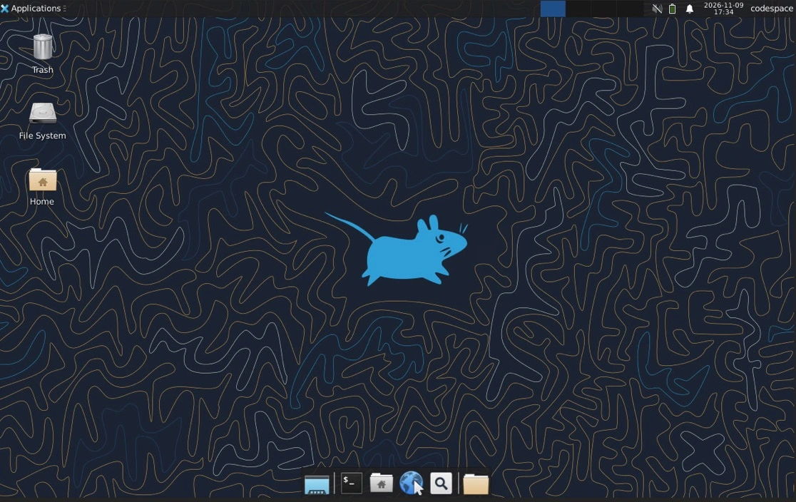
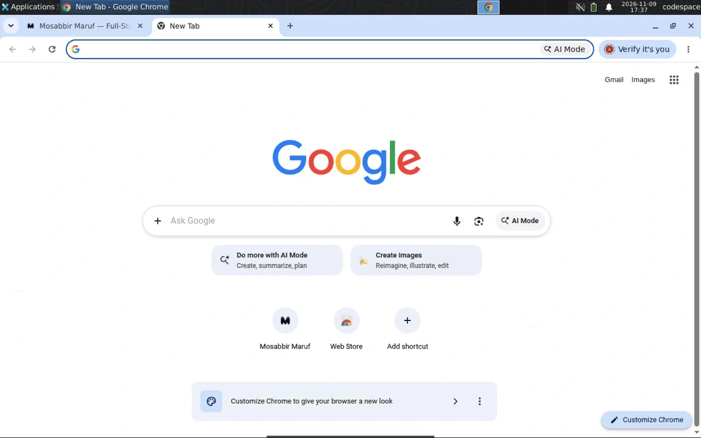

<h1 align="center">Cloud-Chrome</h1>

<p align="center">
  A private Linux desktop with Google Chrome, running in your GitHub Codespace.
  Connect from an ordinary browser; no local Docker, Linux, or VS Code installation is required.
</p>

<p align="center">
  <a href="https://github.com/orgs/mosabbir-maruf/packages/container/package/cloud-chrome">
    
  </a>
  <a href="https://github.com/mosabbir-maruf/Cloud-Chrome/actions/workflows/ci.yml">
    
  </a>
  <a href="https://ubuntu.com/">
    
  </a>
  <a href="https://www.xfce.org/">
    
  </a>
  <a href="https://tigervnc.org/">
    
  </a>
  <a href="https://novnc.com/">
    
  </a>
  <a href="https://www.google.com/chrome/">
    
  </a>
  <a href="LICENSE">
    
  </a>
</p>

<p align="center">
  <strong>Browser access · Persistent profile · Encrypted backups</strong><br />
  <sub>
    Xvnc · XFCE · GNOME Keyring · noVNC · Chrome<br />
    Port <code>6080</code> is forwarded; raw VNC port <code>5900</code> stays loopback-only and must never be forwarded.
  </sub>
</p>

---

## Screenshots

The screenshots below show the XFCE desktop and Chrome running in Cloud-Chrome.

| XFCE desktop | Chrome browser |
|---|---|
|  |  |
| Linux desktop in the Codespace. | Chrome running inside Cloud-Chrome. |

## Key features

- A real XFCE desktop with Chrome, opened in your browser through noVNC.
- A separate Codespace, Chrome profile and GNOME Keyring for each user.
- Persistent state under `.cloudchrome/` in the Codespaces workspace.
- Encrypted backups using age, with a transactional restore.
- Chrome browser-level Google sign-in and Chrome Sync disabled by managed
  policy. Signing in to websites is allowed; that is a separate action.
- Codespaces are configured to use the published prebuilt GHCR image; users
  do not build it locally. Anonymous image access depends on the package
  visibility configured by the repository owner.

## Quick start — use Cloud-Chrome

You need a GitHub account with access to Codespaces and a browser. GitHub
Codespaces compute and storage usage is billed under your account and quota.

1. Open the [Cloud-Chrome repository](https://github.com/mosabbir-maruf/Cloud-Chrome).
2. Select **Code** near the top of the repository page.
3. Open the **Codespaces** tab in the menu.
4. Select **Create codespace on main**. If GitHub asks you to choose a
   machine, select one that meets the project's resource requirements.
5. Wait for the Codespace to be created. It uses the published
   `ghcr.io/mosabbir-maruf/cloud-chrome:latest` prebuilt image; you are not
   asked to build a Docker image on your computer. Successful startup depends
   on that package being accessible to Codespaces. The first initialization
   creates your private state, and the Codespace automatically starts the
   desktop when its container starts.
6. In the Codespaces editor, open **Terminal** → **New Terminal**.
7. Check the desktop status:

   ```bash
   cloudchrome status
   ```

8. Generate or rotate your VNC password in that interactive terminal:

   ```bash
   cloudchrome passwd
   ```

   This command generates and installs a new password, then prints it once
   to the terminal. It does **not** retrieve an existing password. It refuses
   to rotate the password when run without an interactive terminal. Store the
   displayed password somewhere private while you use the desktop; do not
   share it.
9. Open the **Ports** panel in the Codespaces interface. Find forwarded port
   `6080` and select its open-in-browser control.
10. At the noVNC page, enter the VNC password generated in step 8. The desktop
    is ready when the XFCE desktop is visible and a Chrome window appears.
    If the page opens before the desktop is ready, wait briefly and check
    `cloudchrome status` in the terminal.

No local Docker or Linux installation is required; your browser is the
client. Create your own Codespace: access to this repository does not grant
you write permission to the upstream repository. If you want to edit and
commit changes, create your own fork or repository and work there.

## First-time setup and everyday usage

Codespaces runs `cloudchrome init` after creating the container and
`cloudchrome start --if-needed` after starting it. The init command creates
the profile, keyring, credentials, and backup identity without printing
secrets. The password command is intentionally a rotation command; it does
not reveal a password already stored.

| Command | Use |
|---|---|
| `cloudchrome status` | Show supervisor, component and port status. |
| `cloudchrome start` | Start the desktop stack. `cloudchrome start --if-needed` does nothing if it is already running. |
| `cloudchrome stop` | Stop the Cloud-Chrome desktop processes. |
| `cloudchrome restart` | Stop and start the desktop stack. |
| `cloudchrome passwd` | Generate/rotate the VNC password and print the new password to an interactive terminal. |
| `cloudchrome url` | Print the noVNC URL for this Codespace. |
| `cloudchrome doctor` | Check state permissions, processes, ports, keyring health and known host limitation. |
| `cloudchrome logs` | Show recent runtime logs. For example: `cloudchrome logs --component chrome --lines 50`. |
| `cloudchrome backup` | Create an encrypted backup in the managed backup directory. |
| `cloudchrome restore --source PATH` | Restore an encrypted backup. Use `--yes` to skip the confirmation prompt. |
| `cloudchrome prune --keep N` | Review and delete older backups while retaining the newest; `--dry-run` previews. |
| `cloudchrome version` | Print the runtime version. |

`cloudchrome stop` stops only the Cloud-Chrome desktop processes. It does not
stop the GitHub Codespace or release Codespaces compute.
Use the Codespaces interface or `gh codespace stop` (if you use GitHub CLI)
to stop the entire Codespace. Stopping a Codespace preserves its workspace;
deleting it is different and removes the Codespace storage.

See [Usage](docs/USAGE.md) for the complete command reference and exit codes.

## Persistence and backups

The Chrome profile lives in `.cloudchrome/chrome/`. GNOME Keyring data lives
under `.cloudchrome/xdg/keyrings/`, and its unlock passphrase is stored in
`.cloudchrome/keyring.pass`. Chrome uses the keyring through Secret Service
for saved website credentials. The runtime checks that the service can store
and retrieve a test secret before starting Chrome.

The Codespaces workspace is persistent across stopping and restarting the
same Codespace, so the profile, keyring and backups remain available then.
The design places the data on the persistent workspace volume, but
preservation across a Dev Container rebuild has not been verified end to end;
see the pending checks in [Acceptance](docs/ACCEPTANCE.md). Deleting the
Codespace removes its stored workspace state. Do not rely on an untested
rebuild or deleted-Codespace recovery.

Create an encrypted backup:

```bash
cloudchrome backup
```

The command briefly stops the desktop for a consistent snapshot and starts
it again if it was running. To write to a directory that already exists:

```bash
cloudchrome backup --output /tmp/cloudchrome-backup.tar.gz.age
```

The destination directory must already exist when using `--output` for a
backup. Restore from the saved archive:

```bash
cloudchrome restore --source /tmp/cloudchrome-backup.tar.gz.age
```

The interactive restore asks for confirmation. Add `--yes` only when you
intend to replace the current profile and keyring without that prompt. The
restore validates and installs the archive as a transaction; see
[Backup and Restore](docs/BACKUP.md) for its format and recovery behavior.

The encryption identity is `.cloudchrome/keys/backup-identity.txt`. It is
not inside the backup, and it is required to decrypt it. Export the identity
and store it securely **outside the Codespace**, such as in a password
manager. Preserve the encrypted archive outside the Codespace too if you
plan to delete the Codespace. A backup archive without its matching identity
cannot be restored; deletion without externally saved archive and identity
does not provide a recovery path.

## Troubleshooting

Run commands in the Codespaces terminal. Do not expose port `5900`, disable
Chrome's sandbox, use `--no-sandbox`, or weaken security policies to work
around a problem.

| Problem | Likely cause | Diagnose and recover | Details |
|---|---|---|---|
| Codespace fails to start | Codespaces quota, image access, or container startup error. | Read the Codespaces creation log and check your quota. Retry creation after resolving the reported cause; do not try to build the image locally as a workaround. | [Requirements and billing](#requirements-limitations-and-billing), [Usage](docs/USAGE.md) |
| GHCR image pull denied / unauthorized | The package is not public for anonymous pulls, or Codespaces cannot access the package. | Confirm the package is linked to this repository and public-launch visibility was configured by the owner; report the exact Codespaces error. Users should not change package visibility. | [Release checklist](docs/RELEASE.md) |
| Port 6080 is not appearing | The desktop may still be starting or forwarding has not appeared. | Run `cloudchrome status`; wait for startup. If necessary run `cloudchrome start`, then reopen the Ports panel. | [Accessing the desktop](docs/USAGE.md#accessing-the-desktop) |
| noVNC opens but desktop is unavailable | XFCE or another component may not have become healthy yet. | Run `cloudchrome status` and `cloudchrome logs --component supervisor`; wait briefly, then run `cloudchrome doctor`. If the stack is stopped, run `cloudchrome start`. | [Troubleshooting](docs/USAGE.md#troubleshooting) |
| VNC password is rejected | The password may be mistyped or changed. `passwd` does not reveal the old password. | In an interactive Codespaces terminal run `cloudchrome passwd`, note the newly printed password privately, and reconnect. | [VNC password](docs/USAGE.md#the-vnc-password) |
| Chrome does not start | The keyring/Secret Service may be unavailable, or a required component failed. | Run `cloudchrome doctor`, `cloudchrome status`, and `cloudchrome logs --component chrome`; inspect `cloudchrome logs --component keyring` too. Resolve the reported failure, then run `cloudchrome restart` if appropriate. | [Keyring](docs/USAGE.md#the-gnome-keyring) |
| Keyring / Secret Service check fails | The keyring may not have unlocked or its state may be damaged. | Run `cloudchrome doctor` and `cloudchrome logs --component keyring`. Do not remove keyring files as a first step; back up while the desktop is healthy, or restore a known-good backup if needed. | [Backup and Restore](docs/BACKUP.md) |
| Chrome profile appears empty after rebuild | Rebuild persistence is designed around the workspace volume but remains an unverified acceptance item, or a different Codespace/workspace is in use. | Confirm you reopened the same Codespace. Do not delete the Codespace. If you have a valid external backup and matching identity, restore it; otherwise collect diagnostics before changing state. | [Acceptance](docs/ACCEPTANCE.md) |
| Backup cannot be restored | Wrong/missing age identity, damaged archive, or validation failure. | Confirm you have the matching exported identity and complete archive. Retry with `cloudchrome restore --source PATH`; inspect the exact error. Do not overwrite the identity or delete the rollback state. | [Backup and Restore](docs/BACKUP.md) |
| Codespace stopped or quota exhausted | Codespaces was stopped, its usage quota was reached, or spending limits apply. | Resume the same Codespace if available; check account quota and spending limits. Stop the Codespace when not using it; ask the account owner/admin about quota. | [GitHub Codespaces billing](https://docs.github.com/en/billing/managing-billing-for-your-products/managing-billing-for-github-codespaces) |

For more detail see [Usage troubleshooting](docs/USAGE.md#troubleshooting) and
[Acceptance](docs/ACCEPTANCE.md).

## Requirements, limitations, and billing

- A GitHub account with Codespaces access and a normal web browser.
- The configured Codespaces machine requests **2 CPUs, 8 GB RAM, and 32 GB
  storage**. Availability depends on your account and organization.
- Cloud-Chrome does not charge a separate subscription fee. GitHub Codespaces
  compute and storage consumption is billed under your GitHub account and
  applicable quota. Check your current
  [Codespaces billing and usage](https://docs.github.com/en/billing/managing-billing-for-your-products/managing-billing-for-github-codespaces)
  and spending limits; prices and included quotas can change.
- Stopping the Codespace stops continued compute use, but storage may remain
  billable under GitHub's current policies.
- Every user needs their own Codespace. This is not an anonymous public
  desktop hosting service. Keep port `6080`, your VNC password, and your age
  backup identity private.
- A Codespace is independent of repository write access. Users who want to
  commit changes need a fork or another repository they control.

## Architecture and security

The runtime is `bin/cloudchrome`, implemented in `lib/cloudchrome/`. One
supervisor starts six components in dependency order: Xvnc on `:99`, a
private D-Bus session, GNOME Keyring with Secret Service, XFCE, noVNC on
port `6080`, and Chrome. The keyring is verified before Chrome starts.

The configured prebuilt image is `ghcr.io/mosabbir-maruf/cloud-chrome:latest`.
The Dockerfile remains the source used by CI to build and test that image;
the publishing workflow runs only after eligible successful checks on
`main` (or a manual dispatch). Documentation-only changes do not publish a
new image. Existing Codespaces keep their current container until rebuilt.
Anonymous access requires the owner to make the GHCR package public
separately from making repository visibility Public.

Only port `6080` is forwarded for the browser-based noVNC client. Raw VNC
port `5900` is bound to loopback and must never be forwarded. The forwarded
Codespaces port should remain private. Do not share your VNC password or
backup identity. Each person uses their own Codespace, profile, and keyring.

Managed Chrome policy disables browser-level Google account sign-in and
Chrome Sync. This does not prohibit signing into websites; website login and
session behavior are separate and need acceptance testing. See
[Acceptance](docs/ACCEPTANCE.md).

The image retains Chrome's own sandbox, a tailored seccomp profile, no
runtime sudo rule, and no requested `CAP_SYS_ADMIN`. These controls do not
resolve every host-level limitation. In particular, the x86_64 `int 0x80`
compatibility syscall path remains reachable because its host-level control
is not exposed in the Codespace. Cloud-Chrome does **not** claim complete
syscall isolation or a production-security guarantee on hosts where this
remains unresolved. See [Security](docs/SECURITY.md) for measured evidence
and limitations.

## Documentation

Start with the quick start above, or use the guides below for operational
details and project evidence.

| Document | Contents |
|---|---|
| [Usage](docs/USAGE.md) | Commands, exit codes, state layout, and troubleshooting. |
| [Backup and Restore](docs/BACKUP.md) | Encryption, archive format, limits, restore transaction, and recovery. |
| [Security](docs/SECURITY.md) | Security controls, evidence, and unresolved limitations. |
| [Acceptance](docs/ACCEPTANCE.md) | Automated evidence and pending human checks. |
| [Performance](docs/PERFORMANCE.md) | Measurement method and performance results. |
| [Changelog](docs/CHANGELOG.md) | Runtime release notes. |
| [Release checklist](docs/RELEASE.md) | Owner launch and release checks. |

---

## Contributing

Contributions are welcome through a fork or repository you control. Read the
relevant usage, security, backup, and acceptance documents before changing
runtime behavior. Preserve pinned dependencies, the Chrome sandbox, private
port model, and the unresolved syscall limitation in documentation. Run the
tests and validation described in the repository's CI workflow, and never
include `.cloudchrome/`, credentials, browser data, or backup identities in a
change.

## License

Cloud-Chrome's original project code and documentation are offered under the
[MIT License](LICENSE), copyright 2026 Mosabbir Maruf. This license applies
only to material owned by the Cloud-Chrome copyright holder. It does not
relicense third-party software or assets, including Google Chrome, Ubuntu,
XFCE, GNOME Keyring, TigerVNC, noVNC, websockify, age, or their dependencies;
those remain under their respective licenses and terms. Product names and
trademarks remain with their owners. The screenshots show third-party
interfaces and branding and are not claimed as Cloud-Chrome-owned software
or as covered third-party material. Consult the respective project and
vendor notices for their licensing and usage terms.

<p align="center">
  <sub>Cloud-Chrome · A browser-accessible desktop in GitHub Codespaces</sub>
</p>
